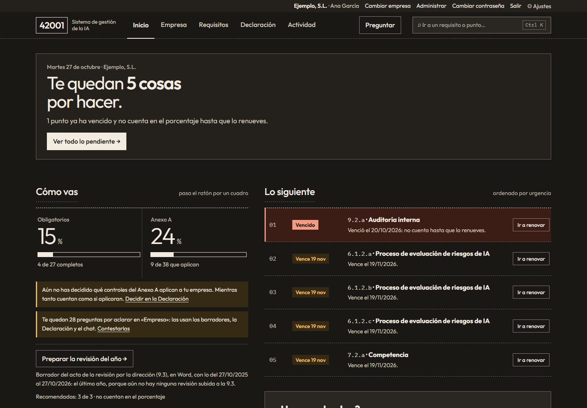
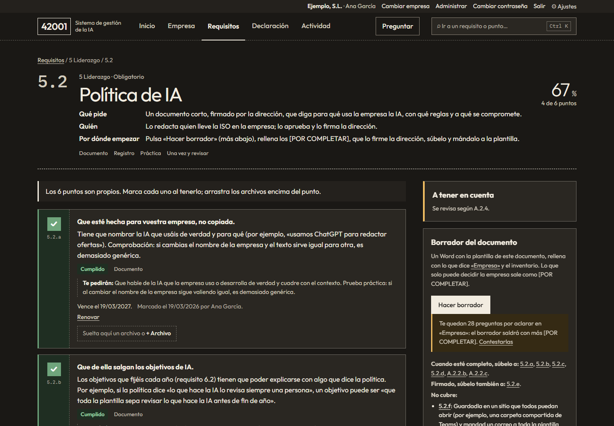

# Portal ISO/IEC 42001

Un portal para llevar al día el sistema de gestión de la inteligencia artificial según la norma **ISO/IEC 42001**:
qué pide la norma, qué tienes hecho, qué vence y dónde están las pruebas. Funciona en tu ordenador, solo o compartido
con tu equipo.

## Qué hace

- **Los requisitos de la norma, explicados en llano:** las cláusulas 4 a 10 y los controles del Anexo A, cada uno con
  los puntos que hay que cumplir y lo que pedirá el auditor.
- **El seguimiento:** qué está cumplido, qué vence y cuándo, y qué toca hacer ahora.
- **Las pruebas, en carpetas:** cada punto tiene su carpeta; lo que subes desde el portal y lo que metes desde el
  Explorador de Windows sale en los dos sitios.
- **La empresa:** un cuestionario sobre cómo usáis la IA y el inventario de vuestros sistemas de IA.
- **La Declaración de Aplicabilidad:** qué controles aplican y por qué, y el documento en Word o PDF.
- **«Ha pasado algo»:** un cambio, un incidente o un sistema nuevo reabren los requisitos a los que afecta.
- **Avisos por correo** de lo que vence, y el registro de quién hizo qué.
- **Ayuda con IA (opcional):** un chat para preguntar dudas, un revisor que dice si un archivo vale para un punto y
  borradores de los documentos que pide la norma, con los datos de tu empresa.

## Qué necesitas

- **Windows** 10 u 11.
- **Python**, gratis. Si no lo tienes, el portal lo dice y abre la página de descarga.
- **Para usarlo en equipo:** una base de datos MySQL y una carpeta compartida.
- **Opcional:** [Claude Code](https://claude.com/claude-code), para las ayudas con IA, y el Outlook clásico, para los
  avisos por correo. Sin ellos, todo lo demás funciona igual.

## Empezar

1. Descarga el portal: botón verde **«Code» → «Download ZIP»** y descomprímelo en una carpeta tuya.
2. Haz doble clic en **`arrancar.bat`**.
3. El portal se abre en el navegador y te guía: elige si lo usas solo en este ordenador o con tu equipo, y crea tu
   cuenta.

Todos los detalles, en el [manual de instalación](docs/instalar.md). Si tienes Claude Code, ábrelo en la carpeta del
portal y escribe «ayúdame a instalar el portal»: te acompaña paso a paso.

## Manuales

- [Instalar y mantener el portal](docs/instalar.md): los dos modos, el MySQL, copias de seguridad, actualizar y
  problemas.
- [Manual de uso](docs/manual.md): el portal, pantalla a pantalla.

## Licencia

El portal tiene una **licencia de uso interno** ([PolyForm Internal Use 1.0.0](LICENSE)). En resumen:

- **Puedes** usarlo y modificarlo para el trabajo interno de tu empresa; todos los que trabajan en ella pueden usarlo.
- **No puedes** pasarle una copia a otra empresa ni a nadie de fuera: quien lo quiera, que lo descargue de aquí,
  [github.com/aracilpau/portal-iso42001](https://github.com/aracilpau/portal-iso42001).
- **Tampoco puedes** venderlo, ofrecerlo como servicio a otros ni instalarlo a un cliente.

Esto es un resumen: el texto que vale es el de [`LICENSE`](LICENSE).

## Aviso

El portal ayuda a llevar al día el sistema de gestión de la IA, pero **no certifica nada** ni sustituye a la norma, a
una auditoría ni al consejo de un experto. La guía que trae explica los requisitos con palabras propias; para la
certificación hace falta la norma original. ISO/IEC 42001 es una norma de ISO e IEC; este portal no está relacionado
con esas organizaciones ni respaldado por ellas. Lo que redacta la IA son borradores: revísalos antes de usarlos. Se
ofrece tal cual, sin garantías.

---

Desarrollado en Movired por Pau Aracil.

---

## In English

A portal to keep your AI management system up to date according to **ISO/IEC 42001**: what the standard requires,
what you have done, what is due and where the evidence is. It runs on Windows, on your own computer or shared with
your team. The portal itself is in Spanish; your browser can translate it.

- [Install and maintain the portal](docs/en/install.md)
- [User manual](docs/en/manual.md)

**License:** internal use only ([PolyForm Internal Use 1.0.0](LICENSE)). You may use and modify it for your company's
internal work. You may not give a copy to anyone outside your company, sell it, offer it as a service or install it for
a client: whoever wants it should download it from here,
[github.com/aracilpau/portal-iso42001](https://github.com/aracilpau/portal-iso42001). It does not certify anything and is not related to or
endorsed by ISO or IEC.
